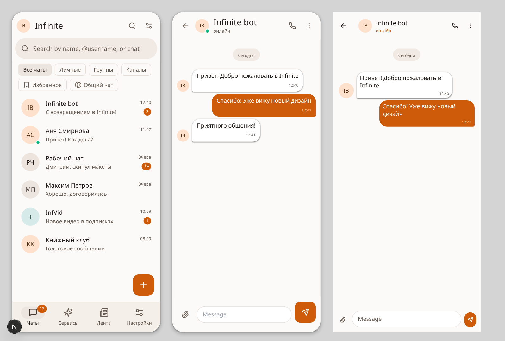
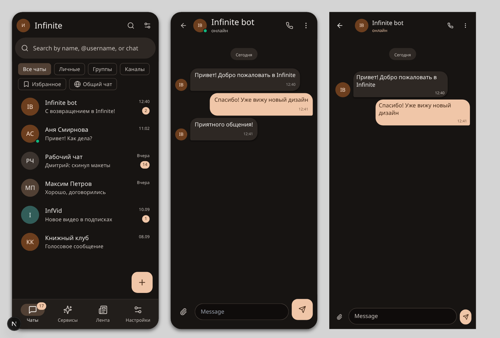

# Material 3 edition — design layer

The Material 3 build (`NEXT_PUBLIC_INFINITE_EDITION=material3`) has its own UI
layer; the classic 1.5 and Material 2 builds never import any of it. This
document describes how the design is wired, so future changes stay inside the
edition.

## 1. Colour: Material You instead of "accent colour"

In the other editions the accent picked in *Settings → Appearance* is applied
verbatim (`--primary: 25 95% 53%`, a saturated orange), which is why the M3
build looked like the classic UI with rounded corners.

In the M3 build that accent is treated as a Material 3 **seed colour** and is
expanded into the full set of Material 3 color roles by
[`src/lib/m3-palette.ts`](../src/lib/m3-palette.ts):

| Role | Light | Dark |
| --- | --- | --- |
| `surface` | warm near-white (tone 98) | warm near-black (tone 8) |
| `surface-container-lowest … highest` | tones 100 / 96 / 94 / 92 / 90 | tones 5 / 10 / 12 / 16 / 21 |
| `primary` / `on-primary` | tinted tone 42 / white | tone 80 / tone 18 |
| `primary-container` / `on-primary-container` | tone 90 / tone 20 | tone 27 / tone 92 |
| `secondary-container` | neutral tone 89 | neutral tone 28 |
| `tertiary-container` | complementary hue (mint) | complementary hue |
| `on-surface` / `on-surface-variant` | tone 11 / 36 | tone 93 / 76 |
| `outline` / `outline-variant` | tone 50 / 87 | tone 58 / 28 |

`theme-context.tsx` calls `applyM3Palette()` **only** when the edition is
`material3`, so the classic palette is untouched for the other builds.

The generated roles are exposed twice:

* as `--md-sys-color-*` (used by the M3 components and by the stylesheet),
* as the legacy semantic variables (`--background`, `--card`, `--primary`,
  `--muted-foreground`, `--border`, …) — that is what makes the *shared*
  screens (chat, settings, dialogs, bot studio, …) follow Material 3 without
  being rewritten.

## 2. Shape, elevation, state

| Token | Value |
| --- | --- |
| `--md3-shape-xs/sm/md/lg/xl` | 4 / 8 / 12 / 16 / 28 dp |
| `--md3-elev-1…4` | M3 elevation levels (soft, 1dp + ambient) |
| `--md3-hover/focus/press` | 0.08 / 0.10 / 0.10 state layers |

Material 3 communicates hierarchy with **tonal surfaces**, not shadows, so the
`header`, `bg-card` and list surfaces are flat; only FABs, menus, sheets and
dialogs get elevation.

## 3. Components

`src/components/m3/m3-theme.css` holds every M3 style (scoped to
`[data-material3="true"]`) and defines reusable classes:

| Class | Used for |
| --- | --- |
| `.m3-app-bar`, `.m3-app-bar-row`, `.m3-app-bar-title` | flat small/large top app bar |
| `.m3-nav-bar`, `.m3-nav-item`, `.m3-nav-item-indicator` | 80dp navigation bar with pill indicators |
| `.m3-chip` | 32dp filter/assist chips (8dp corners) |
| `.m3-fab` | 56dp FAB, 16dp corners, primary |
| `.m3-icon-button` | 44dp icon button with state layer |
| `.m3-search-field` | 56dp search bar (`surface-container-high`) |
| `.m3-list-item` | 72dp list row (conversations, sheets) |
| `.m3-badge`, `.m3-section-label` | unread badge, section label |

React wrappers live in `m3-primitives.tsx` (app bar, icon button, buttons, FAB,
chip, navigation bar), `m3-surfaces.tsx` (card, row, search bar, avatar, empty
state), `m3-chat-row.tsx` and `m3-chat-list.tsx` (conversations screen) and
`m3-shell.tsx` (list + content pane).

## 4. Shared screens in the M3 build

* **Chat** — the header is flattened (surface, no card/shadow), incoming
  bubbles are white tonal cards with a 4dp tail, outgoing bubbles are filled
  `primary` with `on-primary` text, the date separators become label pills and
  the composer is a pill field plus a round filled send button.
* **Dialogs / sheets / menus** — 28dp corners, `surface-container-*` fills,
  no borders, M3 elevation.
* **Text fields, switches** — filled inputs with a 1dp outline (2dp `primary`
  when focused) and the 52×32dp M3 switch.
